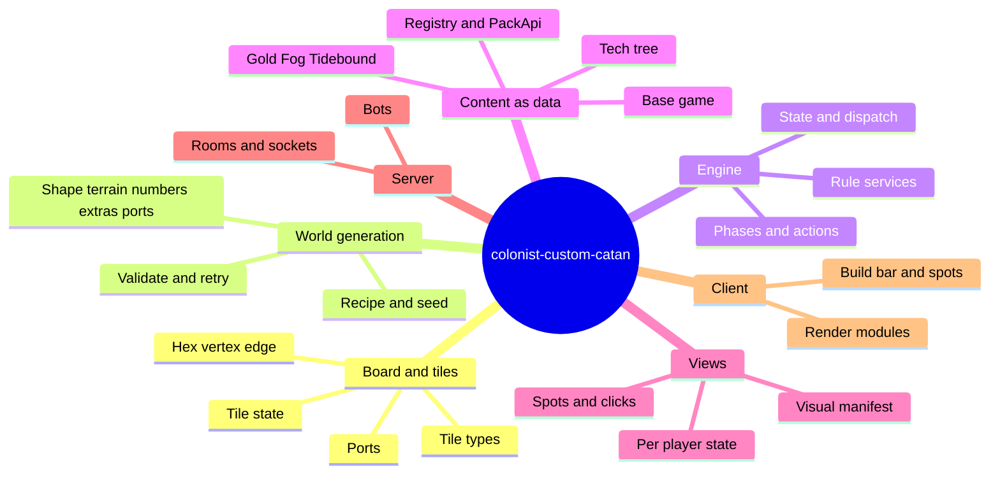
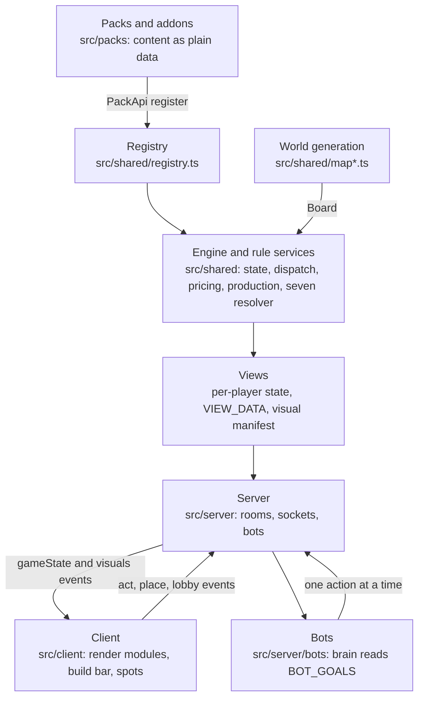
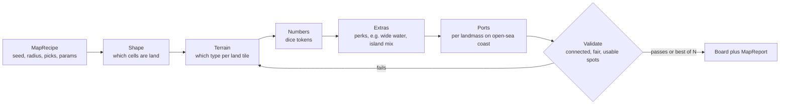

# Architecture (concept map)

Written 2026-11-02. This is the map of **ideas**: what a tile is made of, how a world is generated, how one click becomes a game change. `INDEX.md` says what each *file* does; this file says how the *parts connect* and which files belong to which part. Read this first when you do not know where a change belongs, then go to `ROUTER.md` for the exact files.

## How to keep this file honest

Each domain below ends with an ```` ```owns ```` block: the `src/` files that belong to it. `scripts/mindmap.mjs` reads those blocks and compares them with `INDEX.md`:

```
npm run mindmap          report: files per domain, plus every problem
npm run mindmap:check    same, exit 1 on a problem (tests/mindmap.test.ts runs this)
```

It fails when a `src/` file is in `INDEX.md` but no domain owns it, when a file is claimed twice, when an entry names a file that is gone, or when the Docs table of `INDEX.md` lacks this file. Entries are an exact path, `folder/*` (files directly in the folder) or `folder/**` (everything below). An exact path beats a folder entry. Prose is not checked by the script: when you move a part of the design, reread the domain's text too. After adding, moving or deleting a source file: `npm run index`, then `npm run mindmap:check`.

## 0. The whole thing on one page





Layer rules (enforced by `tests/architecture.test.ts`): `shared` imports only `shared`; a pack imports `shared`, itself and `packs/base`; `server` never imports `client`; `client` imports only `client` and `shared`. The manifest holds no functions for that reason: `client` cannot import `packs`.

## 1. Board and tiles

**A tile (hex)** is one cell of the board. It is *made of* a tile type plus a small record of per-game data:

- **Tile type** (`TileDef`, registered by a pack, e.g. wood, brick, sheep, wheat, ore, desert, water in `packs/base/content.ts`). Flags the code reads: `land`, `noPort`. Gold and fog add their own types in their packs; Tidebound adds sea tiles.
- **The hex record** on the board: `id`, axial `q` and `r`, `type`, `number` (the dice token, or null), `vertexIds` (its six corners) and `ext`, a free bag that content writes into: `hidden` (fog), `river`, `net`, `fish`, `elevation`, `state` (the tile state layer).

**Classified as**
- *Land* (`land` true): resource tiles, desert, gold, fog tiles. They produce, take number tokens and a robber.
- *Sea* (not land, no `noPort`, not a river channel): open water. Only Tidebound gives it a use (fish icons, nets, pirates, wrecks, bridges).
- *Special state* on top of either: `flooded` and `drowned` (tides, rising sea) block production and the robber.

**Vertices and edges.** A vertex has `hexIds` (land tiles only), `edgeIds`, `adjacentVertices`, an optional `port` and a `piece` (settlement, city, or an addon piece). An edge has `v1`, `v2`, `hexIds` and a `piece` (road, bridge). Ports are a property of a *coast vertex*, not a separate board object: a harbor upgrade targets a port vertex.

**What a tile does in play:** it is produced from on a roll (production pipeline), blocked by the robber, changed by tile state (flood, drown, durability), converted by Ground work, fished from (sea tile with a net), and decides where ports and settlements can go.

```owns
src/shared/topology.ts
src/shared/tileState.ts
src/packs/base/constants.ts
src/packs/base/content.ts
src/packs/base/ports.ts
src/packs/base/placement.ts
```

## 2. World generation

**Idea:** a map is a pure function of a *recipe*, so the same share code gives the same map on any engine.



- **Recipe and seed:** `maprecipe.ts` (share code, per-stage RNG streams `seed:stage:attempt`, `GEN_VERSION`), `noise.ts` (seeded value noise, no float tricks).
- **Stages:** `mapshape.ts` (land field), `mapcells.ts` (per-cell height, moisture, coast distance), `mapterrain.ts`, `numbers.ts`, `mapmix.ts` (island resource mix), driven by `mapgen.ts` (`generateMap`) from the options in `mapoptions.ts`.
- **Validation and retry:** `mapcheck.ts` builds the `MapReport`; the board loop retries the later stages and keeps the best, flagging `degraded`.
- **Content:** base shapes, terrain and number styles live in `packs/base/map/*`; a DLC adds a perk with `api.mapPerk` (Tidebound `wide_water`).
- **Lobby side:** the host edits and paints the board (`server/lobby.ts`), the menu comes from the registry's option list (`server/mapmenu.ts`, `client/mapmenu.ts`), presets and the setup page (`server/presets.ts`, `client/presets.ts`, `client/render/setup.ts`).
- **Rule:** generation never reads the player count (`Map Generation Design.md` 5.3).

```owns
src/shared/mapcells.ts
src/shared/mapcheck.ts
src/shared/mapgen.ts
src/shared/mapmix.ts
src/shared/mapoptions.ts
src/shared/maprecipe.ts
src/shared/mapshape.ts
src/shared/mapterrain.ts
src/shared/noise.ts
src/shared/numbers.ts
src/packs/base/map/*
src/server/lobby.ts
src/server/mapmenu.ts
src/server/presets.ts
src/client/mapmenu.ts
src/client/presets.ts
src/client/render/setup.ts
```

## 3. Engine core and game flow

**Idea:** the whole game is a plain-JSON `GameState` that only `dispatch` changes. No sockets, DOM or timers in here, so it runs on the server, the client and in simulations.

- **A turn:** phases (setup, roll, main, discard, robber, steal, pick, gameover) each list which action types are allowed. `shared/engine.ts` has `createGame`, `dispatch`, `legalActions`, the award and win checks.
- **One action:** `checkAction` (game not over, player exists, phase lists the action, the actor rule allows this player) then `def.validate`, then `def.apply`. `ctx` hands apply and hooks the state, the registry and `emit` (a client effect) and `log`.
- **Randomness:** seeded `rng.ts` (mulberry32, state is plain JSON). Addon code draws no `g.rng` numbers unless the base game already does there; it derives its own stream.
- **State helpers:** `state.ts` (players, bank, costs, phases, production, VP, turn start), `types.ts` (the core types), `palette.ts` (player colors).

```owns
src/shared/index.ts
src/shared/ctx.ts
src/shared/engine.ts
src/shared/rng.ts
src/shared/state.ts
src/shared/types.ts
src/shared/palette.ts
```

## 4. Registry, packs and addons (content is data)

**Idea:** the engine does not know any content. A *pack* (base, gold, fog, tidebound) registers pieces, actions, tiles, phases, hooks and keyed registries through `PackApi`; an *addon* is a switchable part of a pack. A disabled addon registers nothing, so it changes nothing.

- `registry.ts`: the registry, `PackApi`, `PieceDef`, `ActionDef`, hooks (`onRoll`, `onRoundStart`, `onTurnStart`, ...), `api.define(<keyed registry>, def)`.
- `addons.ts`: the manifest, enabled-set resolution, the link audit (Rule of Two).
- Pack list in `packs/index.ts`; load order base, gold, fog, tidebound. `addons.generated.ts` per pack is produced by `npm run addons` in dependency order.
- `packs/_template/*`: the copy-me addon (`demo.ts`) and the one-file proof piece (`lantern.ts`).
- Keyed registries (full list in `EXTENSION POINTS.md`): `VIEW_DATA`, `BOT_GOALS`, `COST_MODS`, `RATIO_MODS`, `WILD_TOKENS`, `SEVEN_STEPS`, `PORT_IDLE_CHECKS`, `OVERLAY_KINDS` and more.

```owns
src/shared/registry.ts
src/shared/addons.ts
src/packs/index.ts
src/packs/_template/*
```

## 5. Rule services (shared services the engine and packs call)

Small pure services, each with one owner file. Order matters in the ones that are pipelines.

- **Pricing** (`pricing.ts`): piece cost and limits, doubled cost above the base limit, cost modifiers.
- **Trade ratio** (`tradeRatio.ts`): `ratioFor` with an ordered modifier chain and a 2:1 floor.
- **Production** (`production.ts`): ordered stages (number shift, tile state, base yield, piece multiplier, wild token, tax, bank-short, discard check).
- **Seven Resolver** (`sevenResolver.ts`): ordered steps for discard, robber, collapse and so on.
- **Event deck** (`eventDeck.ts`), **history and stats** (`history.ts`), **markers, ledger, strength, relations** (`coreServices.ts`).

```owns
src/shared/pricing.ts
src/shared/tradeRatio.ts
src/shared/production.ts
src/shared/sevenResolver.ts
src/shared/eventDeck.ts
src/shared/history.ts
src/shared/coreServices.ts
```

## 6. Base game rules

The standard game as a pack: resources and tiles, the road, settlement and city, development cards, awards (longest road, largest army), the setup snake, building validation, the robber, trading, and every base action (`roll`, `build`, `bank_trade`, `buy_dev`, `end_turn`, trade offers, `move_robber`, `discard`, `pick`).

```owns
src/packs/base/index.ts
src/packs/base/actions/index.ts
src/packs/base/actions/bankTrade.ts
src/packs/base/actions/build.ts
src/packs/base/actions/devCards.ts
src/packs/base/actions/endTurn.ts
src/packs/base/actions/owed.ts
src/packs/base/actions/robber.ts
src/packs/base/actions/roll.ts
src/packs/base/actions/tradeOffers.ts
src/packs/base/awards.ts
src/packs/base/building.ts
src/packs/base/devcards.ts
src/packs/base/hooks.ts
src/packs/base/longestRoad.ts
src/packs/base/phases.ts
src/packs/base/picks.ts
src/packs/base/pieces.ts
src/packs/base/robbing.ts
src/packs/base/setup.ts
src/packs/base/trading.ts
```

## 7. Tech tree

Spend wheat and ore on techs. The cost formula and the Stage 1 general features live in `shared/stage1.ts`; the five base root techs and their effects in `techEffects.ts` and `techRoots.ts`; the actions `research_tech`, `upgrade_port` and `convert_tile` in `base/actions`. Tidebound adds nodes in `tidebound/tech.ts` and gates features with `techGate(g, pid, techId)`. The panel is `client/render/techpanel.ts` with its pan and zoom maths in `client/techView.ts`. Spec: `Tech Tree Design.md`.

```owns
src/shared/stage1.ts
src/packs/base/actions/research.ts
src/packs/base/actions/techActions.ts
src/packs/base/techEffects.ts
src/packs/base/techRoots.ts
src/client/render/techpanel.ts
src/client/techView.ts
```

## 8. DLC packs

- **gold**: a tile that lets you pick a resource on production.
- **fog**: tiles hidden until you build next to them.
- **tidebound**: the big one. Sea tiles and wide water, bridges and rickety bridges, tides and rising sea (tile state `flooded` and `drowned`), fishing (fish token, nets on sea tiles, fish icons, feeding the sea), harbors (1:1 ports), wrecks, pirates, and its own tech nodes. Each part is an addon with `links` so the audit can check its dependencies.

```owns
src/packs/fog/*
src/packs/gold/*
src/packs/tidebound/*
```

## 9. Views and the visual manifest

**Idea:** the client gets a per-player filtered copy of the state, and DLC pieces and actions describe themselves as plain data so the client needs no per-piece code.

- **Per-player state:** `shared/views.ts` hides other hands and hidden tiles; `server/view.ts` builds the `gameState` the client renders and merges every `VIEW_DATA` entry an addon registered (`shared/viewData.ts`).
- **Manifest:** a piece or action may carry a `visual` (`shared/visual.ts`): a slot (`vertex`, `edge`, `edge:ocean`, `hex`), a button, hint texts, and for an action the payload field that carries the spot (`spotKey`). `visualManifest.ts` builds and checks it; the server sends it once per addon set in a `visuals` event.
- **Spots:** `packs/base/piecesView.ts` (`base.pieces_view`) sends each player `pieces[id] = { left, cost, spots }`. For a piece the spots come from the `build` validation; for an action from `legal()` filtered through `validate`, mapped by `spotKey`. The highlighted spots therefore cannot disagree with what the server accepts.
- **Client side:** `pieceModel.ts` (pure: buttons, hints, spot markup), `pieceui.ts` (DOM and clicks: `clickSpot` emits `place` for a piece, `act` for an action), `visuals.ts` (the held manifest), `render/overlay.ts` (tile tints and popups), plus the tier 2 modules that stay code: `render/pirates.ts`, `render/bridgepicker.ts`, `pirateIcon.ts`, `icons.ts`.
- **A "target action"** (act on an existing tile, port or vertex, e.g. feed the sea, harbor upgrade, ground work) is an `ActionDef` with a `visual`: it shares this whole path. It is not a piece. Plan: `Spot Actions Rework.md`.

```owns
src/shared/views.ts
src/shared/viewData.ts
src/shared/visual.ts
src/shared/visualManifest.ts
src/packs/base/piecesView.ts
src/server/view.ts
src/client/pieceModel.ts
src/client/pieceui.ts
src/client/visuals.ts
src/client/icons.ts
src/client/pirateIcon.ts
src/client/render/overlay.ts
src/client/render/pirates.ts
src/client/render/bridgepicker.ts
```

## 10. Server

A thin adapter over the engine. `main.ts` (Express, Socket.io, `/health`), `rooms.ts` (rooms and roster), `socket.ts` (lobby editing; the generic `act` and `place` events; the old base events), `game.ts` (start, rematch, dispatch one action, turn engine events into client effects), `net.ts` (broadcast: each player their own view, the `visuals` event, wakes the bots), `runtime.ts` (registry and settings to rules), `turnClock.ts`, `turnHistory.ts`, `persistence.ts` (cross-game bot memory), `types.ts`, `util.ts`. The lobby, map menu and preset files are in domain 2, `view.ts` in domain 9.

```owns
src/server/*
```

## 11. Bots

`brain.ts` is pure: game state in, one action out. It names no DLC content: a DLC tells it what its content is worth through `BotGoalDef` registered with `BOT_GOALS` (`shared/botGoals.ts`), gated by tier. Tiers Main, Secondary, Overload (`tiers.ts`), the per-board `mapProfile.ts`, the `scheduler.ts` (one bot acts per broadcast after a delay), the `sim.ts` bot-vs-bot simulator, the training logger, and the chat engine in `dialogue/`.

```owns
src/shared/botGoals.ts
src/server/bots/**
```

## 12. Client

The browser app: one store (`store.ts`), one socket (`socket.ts`), `main.ts` wiring DOM events, camera and socket messages, and a set of render modules called from `render/index.ts` (`renderAll`): board SVG, hand, sidebar, trade, drawer, turn clock. Everything DLC draws comes from view data or the manifest. Files owned by other domains (manifest UI, tech panel, map menu, setup page) are listed there.

```owns
src/client/*
src/client/render/*
```

## Where a change belongs (quick table)

| You want to... | Domain | Then open |
|---|---|---|
| change what a tile type is or does | 1, 4 | `packs/base/content.ts`, `ROUTER.md` row "New piece" or "Event card, seven step..." |
| change how maps look or validate | 2 | `Map Generation Design.md`, `shared/mapgen.ts` |
| add a rule, piece or action | 4, 6 or 8 | `RECIPES.md` |
| show something new to the player | 9 | `Visual Manifest Design.md` |
| make a bot care about it | 11 | `Bot AI Design.md`, `BOT_GOALS` |
| click a tile, port or vertex to do an action | 9 | `Spot Actions Rework.md` |
